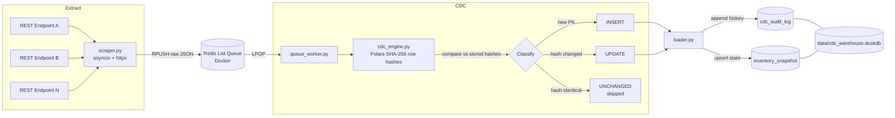

# Asynchronous Ingestion & Hash-Based Change Data Capture (CDC) Engine


A high-concurrency ingestion and Change Data Capture (CDC) engine. It scrapes multiple REST endpoints concurrently, buffers raw payloads in a Redis task queue, computes deterministic SHA-256 row-level signatures with Polars, and merges only the real changes into DuckDB, while keeping a full audit trail of every mutation.

---

## Architecture



### Workflow

1. **Scraper engine:** `scraper.py` uses `asyncio` and `httpx` to hit multiple product/inventory endpoints concurrently without blocking.
2. **Buffer queue:** Raw JSON payloads are pushed into a containerized Redis list (`RPUSH`), and the worker consumes them with `LPOP`. This decouples extraction speed from database write speed.
3. **CDC engine:** The worker pops a payload, and Polars computes a deterministic SHA-256 signature for each row. Those hashes are compared to the hashes already in DuckDB, and each row is classified:
   - `INSERT`: the primary key is not yet in the warehouse.
   - `UPDATE`: the primary key exists but its data hash has changed.
   - `UNCHANGED`: the record is identical and is skipped during the write pass.
4. **Persistence:** `loader.py` appends the full mutation history to `cdc_audit_log` and upserts current state into `inventory_snapshot`.

---

## Key Features & Technical Highlights

- **Non-blocking async I/O.** Network latency dominates scraping time. With `asyncio` and `httpx`, many endpoint requests are in flight at once on a single thread, avoiding thread-pool overhead for an I/O-bound workload.
- **Decoupled queue architecture.** Redis sits between extraction and persistence, so a slow or locked database write never stalls scraping, and bursts of data are absorbed by the buffer. The trade-off is one more moving part (a container to run) and at-most-once semantics with a plain `LPOP` list: a worker crash after popping can lose that payload. A reliable-queue pattern (`LMOVE` to a processing list) would be the next step if that matters.
- **Vectorized hash-delta calculation.** Row hashes are computed with Polars column expressions rather than Python loops, and comparisons against stored hashes are done as joins. Cost scales with columnar operations, not per-row interpreter overhead.
- **Deterministic signatures.** Hashing a fixed column order with a consistent serialization means the same data always yields the same SHA-256, so a changed hash reliably means changed content.
- **Write minimization.** `UNCHANGED` rows are skipped entirely, so the warehouse only absorbs genuine mutations. This keeps writes small even when the source is re-scraped frequently.
- **Full auditability.** `cdc_audit_log` is append-only and records every `INSERT` and `UPDATE`, so history can be replayed or inspected, while `inventory_snapshot` always holds the latest state.
- **Embedded warehouse.** DuckDB needs no server. Its single-writer model fits a single queue worker, which is why the worker is the only component that writes.

---

## Directory Layout

```text
async-cdc-engine/
├── data/
│   └── cdc_warehouse.duckdb    # DuckDB: inventory_snapshot + cdc_audit_log
├── src/
│   ├── scraper.py              # Async multi-endpoint extraction (asyncio + httpx)
│   ├── queue_worker.py         # Redis RPUSH / LPOP producer and consumer
│   ├── cdc_engine.py           # Polars SHA-256 hashing and INSERT/UPDATE/UNCHANGED classification
│   └── loader.py               # Audit log append + snapshot upsert
├── main.py                     # Pipeline entrypoint
├── requirements.txt
└── README.md
```

---

## Quickstart

### Prerequisites

- Python 3.11+
- Docker (for Redis)

### 1. Clone and create a virtual environment

```bash
git clone https://github.com/<your-username>/async-cdc-engine.git
cd async-cdc-engine

python3.11 -m venv .venv
source .venv/bin/activate        # Windows: .venv\Scripts\activate
pip install --upgrade pip
pip install -r requirements.txt
```

### 2. Start Redis in Docker

```bash
docker run -d --name cdc-redis -p 6379:6379 redis:7-alpine
docker exec cdc-redis redis-cli ping     # expect: PONG
```

### 3. Run the engine

```bash
python main.py
```

### 4. Observe CDC behavior

Run it a second time. If the source data has not changed, nearly every row should be classified `UNCHANGED` and nothing new is written:

```bash
python main.py
```

### 5. Query the warehouse

```bash
duckdb data/cdc_warehouse.duckdb
```

```sql
-- Current state
SELECT COUNT(*) FROM inventory_snapshot;

-- Mutation history, grouped by operation
SELECT operation, COUNT(*) AS n
FROM cdc_audit_log
GROUP BY operation
ORDER BY n DESC;

-- Most recent changes
SELECT * FROM cdc_audit_log ORDER BY 1 DESC LIMIT 10;
```

Adjust column names (such as `operation`) to match your schema if they differ.

### 6. Inspect the queue (optional)

```bash
docker exec cdc-redis redis-cli LLEN <queue_name>
```

### 7. Clean up

```bash
docker stop cdc-redis && docker rm cdc-redis
deactivate
```

---

## Tech Stack

| Layer            | Tool                                  |
| ---------------- | ------------------------------------- |
| Language         | Python 3.11+ (`asyncio`)              |
| HTTP client      | httpx (async)                         |
| Buffer queue     | Redis (Docker), list `RPUSH` / `LPOP` |
| Hashing / deltas | Polars, SHA-256                       |
| Warehouse        | DuckDB                                |